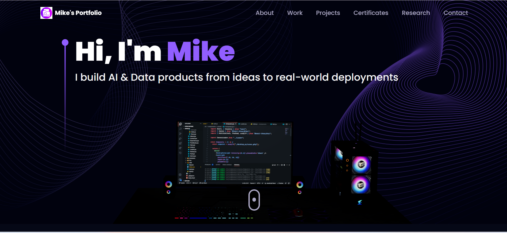

<div align="center">

# Mike Benis B · 3D AI Portfolio

**An interactive 3D developer portfolio built with React, Three.js and Tailwind CSS.**
Clone it, swap in your own details, and ship it in an afternoon.

[](LICENSE)
[](https://react.dev)
[](https://www.typescriptlang.org)
[](https://vitejs.dev)
[](https://threejs.org)
[](https://tailwindcss.com)

[Live demo](https://portfolio-mu-orpin-42.vercel.app/) · [Report a bug](../../issues) · [Request a feature](../../issues)

</div>



---

## Table of contents

- [Features](#features)
- [Tech stack](#tech-stack)
- [Getting started](#getting-started)
- [Project structure](#project-structure)
- [Make it yours](#make-it-yours)
- [Contact form setup](#contact-form-setup)
- [Deployment](#deployment)
- [Forking and reworking this project](#forking-and-reworking-this-project)
- [Contributing](#contributing)
- [License](#license)
- [Credits](#credits)
- [Contact](#contact)

## Features

- **3D hero and contact scenes** powered by React Three Fiber: an animated desk setup and a rotating planet.
- **Interactive skill balls.** 28 skills rendered as 3D balls that bulge and glow on hover, show a short description of the tool, and can be dragged to spin.
- **Experience and education timeline** with animated cards.
- **Project cards** with tilt and glare effects, tags and links to the source code.
- **Certificates section** with an image for each certificate and a placeholder when an image is missing.
- **Research papers section** that tags your own papers and your favourite reads.
- **Working contact form** that delivers messages straight to your inbox, with no backend and no API keys.
- **Social links** for GitHub, LinkedIn and Instagram.
- **Fully typed content.** Every piece of text lives in typed config files, so you rarely touch component code.
- **Responsive layout** from phones to wide desktop screens.

## Tech stack

| Area | Tools |
| --- | --- |
| Framework | React 18, TypeScript, Vite 5 |
| 3D | Three.js, React Three Fiber, Drei, maath |
| Styling | Tailwind CSS 3 |
| Animation | Framer Motion, react-parallax-tilt |
| UI components | react-vertical-timeline-component, React Router |
| Tooling | ESLint, Prettier |
| Contact form | FormSubmit (no account needed) |

## Getting started

### Prerequisites

- [Node.js](https://nodejs.org) 18 or newer
- npm (bundled with Node.js)
- [Git](https://git-scm.com)

### Installation

```bash
# 1. Clone the repository
git clone https://github.com/Mikebenisberchmans/reactjs18-3d-portfolio.git

# 2. Move into the project folder
cd reactjs18-3d-portfolio

# 3. Install dependencies
npm install

# 4. Start the development server
npm run dev
```

Vite prints a local address (usually `http://localhost:5173`). Open it in your browser and the page reloads as you edit files.

### Available scripts

| Command | What it does |
| --- | --- |
| `npm run dev` | Starts the development server with hot reload |
| `npm run build` | Type-checks with `tsc`, then creates a production build in `dist/` |
| `npm run preview` | Serves the production build locally for a final check |
| `npm run lint` | Runs ESLint over all TypeScript files |
| `npm run ts:check` | Type-checks the project without building |

> **Tip:** run `npm run build` before you push. The build fails on any TypeScript error, including unused variables, and so will your deployment.

## Project structure

```text
.
├── public/
│   ├── certificates/        # Your certificate images (see README.txt inside)
│   ├── desktop_pc/          # 3D model for the hero scene
│   ├── planet/              # 3D model for the contact scene
│   └── logo.svg             # Favicon and navbar logo
├── src/
│   ├── assets/              # Images, tech logos, project covers, icons
│   ├── components/
│   │   ├── atoms/           # Small shared pieces (section header, social icons)
│   │   ├── canvas/          # 3D scenes: computers, earth, stars, skill balls
│   │   ├── layout/          # Navbar and 3D loader
│   │   └── sections/        # About, Experience, Tech, Works, Certificates,
│   │                        # Research, Contact, Hero
│   ├── constants/
│   │   ├── config.ts        # Name, links, headings, hero and about text
│   │   ├── index.ts         # Skills, experience, certificates, papers, projects
│   │   └── styles.ts        # Shared spacing and text styles
│   ├── hoc/                 # Section wrapper used for scroll animation
│   ├── types/               # TypeScript types for all content
│   ├── utils/               # Animation variants
│   ├── App.tsx
│   └── main.tsx
├── index.html               # Page title and meta description
└── tailwind.config.cjs      # Colour palette and breakpoints
```

## Make it yours

Almost everything you need to change is in two files. You should not need to edit any component to personalise the site.

### 1. Your details: `src/constants/config.ts`

| Field | What it controls |
| --- | --- |
| `html.title` | Browser tab title and navbar text |
| `html.fullName` | Your full name |
| `html.email` | Where contact form messages are delivered |
| `socials` | GitHub, LinkedIn and Instagram links |
| `hero` | Your name and the two lines under it on the landing screen |
| `sections.*` | Small heading, big heading and intro text for every section |

Also update the `<title>` and `description` meta tag in `index.html`.

### 2. Your content: `src/constants/index.ts`

| Export | What it controls |
| --- | --- |
| `navLinks` | Navbar items |
| `services` | The four cards in the About section |
| `skills` | The 3D skill balls |
| `experiences` | The experience and education timeline |
| `certificates` | Certificate cards |
| `papers` | Research paper cards |
| `projects` | Project cards |

**Add a skill.** Each skill needs a `name` and a `description` (shown in the hover card). Then choose how the ball looks:

```ts
// Option A: a logo image
{ name: "Docker", icon: docker, description: "Containers that package apps to run anywhere." },

// Option B: a coloured monogram, no image needed
{ name: "Python", monogram: "Py", color: "#3776AB", description: "General-purpose language for ML and APIs." },
```

For Option A, place a square PNG (about 240 by 240 px) in `src/assets/tech/`, then export it from `src/assets/index.ts`.

**Add a project.** Put a cover image in `src/assets/projects/`, export it from `src/assets/index.ts`, then add an entry to `projects`:

```ts
{
  name: "My Project",
  description: "One or two sentences about what it does.",
  tags: [
    { name: "react", color: "blue-text-gradient" },
    { name: "fastapi", color: "green-text-gradient" },
    { name: "postgres", color: "pink-text-gradient" },
  ],
  image: myProject,
  sourceCodeLink: "https://github.com/your-username/my-project",
},
```

Available tag colours: `blue-text-gradient`, `green-text-gradient`, `pink-text-gradient`, `orange-text-gradient`.

**Add a certificate.** Add an entry to `certificates` and drop the image into `public/certificates/` using the same file name as the `image` path. Until the file exists, a placeholder badge is shown. Add `link: "https://..."` to make the card open the credential page.

**Add a paper.** Add an entry to `papers`. Set `badge: "mine"` for your own work or `badge: "favorite"` for papers you admire.

### 3. Images, colours and 3D models

- **Logo and favicon:** replace `public/logo.svg` and `public/logo.png`.
- **Colour theme:** edit the `colors` block in `tailwind.config.cjs`.
- **Hero background:** replace `src/assets/herobg.png`.
- **3D models:** the files in `public/desktop_pc` and `public/planet` are loaded by `src/components/canvas/Computers.tsx` and `Earth.tsx`. If you swap a model, keep its attribution file and credit the author (see [Credits](#credits)).

## Contact form setup

The form sends messages through [FormSubmit](https://formsubmit.co), so there is no server to run and no API key to manage.

1. Set your email address in `src/constants/config.ts` (`html.email`).
2. Run the site (locally or deployed) and send one test message.
3. FormSubmit emails you an **activation link** the first time. Open it and confirm.
4. From then on, every message arrives in your inbox, and replying goes straight to the sender.

If the first test message does not appear, check your spam folder for the activation email.

## Deployment

This is a static site, so any static host works. The steps below use [Vercel](https://vercel.com).

1. Push your project to GitHub.
2. Go to [vercel.com/new](https://vercel.com/new), sign in with GitHub and import the repository.
3. Confirm the settings, which Vercel normally detects on its own:
   - **Framework preset:** Vite
   - **Build command:** `npm run build`
   - **Output directory:** `dist`
4. Click **Deploy**.

No environment variables are needed. Every push to your main branch triggers a new deployment automatically. The same build settings work on Netlify and Cloudflare Pages.

## Forking and reworking this project

You are free to use this project as the starting point for your own portfolio.

1. **Fork or clone** the repository.
   - Fork on GitHub, then clone your fork, or clone directly and point the remote at your own new repository:
     ```bash
     git clone https://github.com/Mikebenisberchmans/reactjs18-3d-portfolio.git my-portfolio
     cd my-portfolio
     git remote set-url origin https://github.com/<your-username>/my-portfolio.git
     ```
2. **Install and run** with `npm install` and `npm run dev`.
3. **Replace the personal content.** Everything about me (name, bio, experience, certificates, papers, project descriptions, social links and cover images) is sample content. Swap it for your own using the [Make it yours](#make-it-yours) guide, and remove anything that is not yours.
4. **Check the build** with `npm run build` so you catch type errors early.
5. **Deploy** using the [Deployment](#deployment) steps.
6. **Keep the license and credits.** Leave the `LICENSE` file in place and keep the [Credits](#credits) section. Add your own name to the license as described below.

### Good ideas to build on

- Add a blog or case-study page with React Router.
- Replace the monogram skill balls with official logos.
- Swap the 3D models for your own scenes.
- Add analytics, a sitemap and Open Graph tags for sharing previews.

## Contributing

Contributions, bug reports and suggestions are welcome.

1. Fork the repository and create a branch: `git checkout -b feature/your-feature`
2. Make your changes and run `npm run lint` and `npm run build`.
3. Commit with a clear message: `git commit -m "Add your feature"`
4. Push the branch and open a pull request.

## License

This project is released under the **MIT License**, so you can use, copy, modify, merge, publish, distribute, sublicense and sell it, for personal or commercial work, as long as you keep the copyright notice and license text in your copies. See the [LICENSE](LICENSE) file for the full text.

The software is provided "as is", without warranty of any kind.

Third-party 3D models in `public/` are **not** covered by the MIT License. They are published by their authors under their own licenses (see [Credits](#credits)).

## Credits

- **Template foundation:** this portfolio is built on [ladunjexa/reactjs18-3d-portfolio](https://github.com/ladunjexa/reactjs18-3d-portfolio). Thank you for the excellent starting point.
- **Stylized planet** (`public/planet`) by [cmzw](https://sketchfab.com/cmzw), licensed under [CC BY 4.0](http://creativecommons.org/licenses/by/4.0/). Source: [Sketchfab](https://sketchfab.com/3d-models/stylized-planet-789725db86f547fc9163b00f302c3e70).
- **Desktop PC model** (`public/desktop_pc`): author and license details are in `public/desktop_pc/license.txt`.
- **Libraries:** [React](https://react.dev), [Three.js](https://threejs.org), [React Three Fiber](https://docs.pmnd.rs/react-three-fiber), [Drei](https://github.com/pmndrs/drei), [Framer Motion](https://www.framer.com/motion/), [Tailwind CSS](https://tailwindcss.com), [Vite](https://vitejs.dev).
- **Contact form:** [FormSubmit](https://formsubmit.co).

## Contact

**Mike Benis B** · Data Science graduate and AI product builder

- GitHub: [@Mikebenisberchmans](https://github.com/Mikebenisberchmans)
- LinkedIn: [linkedin.com/in/mike-beni](https://linkedin.com/in/mike-beni)
- Instagram: [@\_\_mik\_\_al\_\_\_ben\_\_](https://www.instagram.com/__mik__al___ben__)
- Email: [mikebenisberchmans@gmail.com](mailto:mikebenisberchmans@gmail.com)

If this project helped you, consider giving it a star on GitHub.
